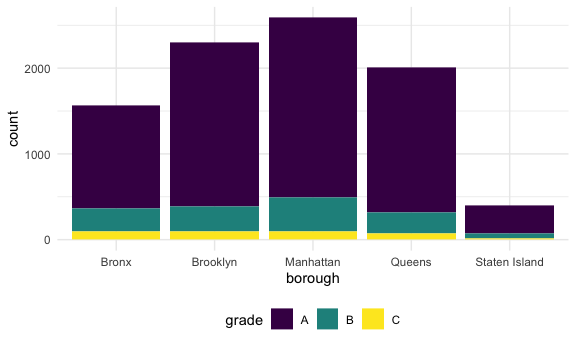
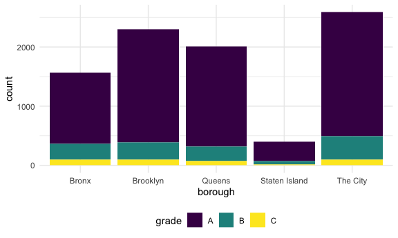
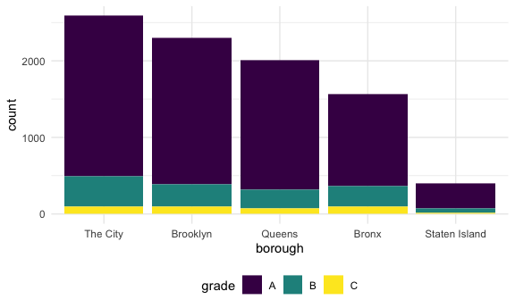

Strings and factors
================

``` r
library(rvest)
```

    ## 
    ## Attaching package: 'rvest'

    ## The following object is masked from 'package:readr':
    ## 
    ##     guess_encoding

``` r
library(p8105.datasets)
```

## strings and regex

``` r
string_vec = c("my", "name", "is", "jeff")

str_detect(string_vec, "jeff")
```

    ## [1] FALSE FALSE FALSE  TRUE

``` r
str_detect(string_vec, "My")
```

    ## [1] FALSE FALSE FALSE FALSE

``` r
str_detect(string_vec, "my")
```

    ## [1]  TRUE FALSE FALSE FALSE

``` r
str_replace(string_vec, "my", "My")
```

    ## [1] "My"   "name" "is"   "jeff"

``` r
string_vec = c(
  "i think we all rule for participating",
  "i think i have been caught",
  "i think this will be quite fun actually",
  "it will be fun, i think"
  )

str_detect(string_vec, "i think")
```

    ## [1] TRUE TRUE TRUE TRUE

``` r
str_detect(string_vec, "^i think")
```

    ## [1]  TRUE  TRUE  TRUE FALSE

``` r
str_detect(string_vec, "i think$")
```

    ## [1] FALSE FALSE FALSE  TRUE

``` r
string_vec = c(
  "Time for a Pumpkin Spice Latte!",
  "went to the #pumpkinpatch last weekend",
  "Pumpkin Pie is obviously the best pie",
  "SMASHING PUMPKINS -- LIVE IN CONCERT!!"
  )

str_detect(string_vec, "[Pp]umpkin")
```

    ## [1]  TRUE  TRUE  TRUE FALSE

``` r
string_vec = c(
  '7th inning stretch',
  '1st half soon to begin. Texas won the toss.',
  'she is 5 feet 4 inches tall',
  '3AM - cant sleep :('
  )

str_detect(string_vec, "[0-9][a-zA-Z]")
```

    ## [1]  TRUE  TRUE FALSE  TRUE

``` r
string_vec = c(
  'Its 7:11 in the evening',
  'want to go to 7-11?',
  'my flight is AA711',
  'NetBios: scanning ip 203.167.114.66'
  )

str_detect(string_vec, "7.11")
```

    ## [1]  TRUE  TRUE FALSE  TRUE

``` r
string_vec = c(
  'The CI is [2, 5]',
  ':-]',
  ':-[',
  'I found the answer on pages [6-7]'
  )

str_detect(string_vec, "\\[")
```

    ## [1]  TRUE FALSE  TRUE  TRUE

## quick note on factors

``` r
vec_sex = factor(c("male", "male", "female", "female"))

as.numeric(vec_sex)
```

    ## [1] 2 2 1 1

``` r
vec_sex = fct_relevel(vec_sex, "male")

as.numeric(vec_sex)
```

    ## [1] 1 1 2 2

## Import NSDUH

``` r
url = "https://www.samhsa.gov/data/sites/default/files/NSDUHsaeShortTermCHG2015/NSDUHsaeShortTermCHG2015.htm"

drug_use_html = 
  read_html(url)
```

Pull the table out

``` r
marj_df = 
  drug_use_html |> 
  html_table() |> 
  first() |> 
  slice(-1) |> 
  select(-contains("P Value")) |> 
  pivot_longer(
    -State, 
    names_to = "age_year", 
    values_to = "prev"
  ) |> 
  separate(age_year, into = c("age", "year"), sep = "\\(") |> 
  mutate(
    year = str_replace(year, "\\)", ""), 
    prev = str_replace(prev, "[a-c]", ""),
    prev = as.numeric(prev)
  )
```

make a quick plot

``` r
marj_df |> 
  filter(age == "12-17") |> 
  mutate(State = fct_reorder(State, prev)) |> 
  ggplot(aes(x = State, y = prev, color = year)) + 
  geom_point() + 
  theme(axis.text.x = element_text(angle = 90, hjust = 1))
```


## NYC Airbnb

``` r
data(nyc_airbnb)

nyc_airbnb |> 
  filter(
    neighbourhood_group == "Manhattan",
    price < 1000) |> 
  mutate(neighbourhood = fct_reorder(neighbourhood, price)) |> 
  ggplot(aes(x = neighbourhood, y = price)) + 
  geom_boxplot() + 
  coord_flip()
```


## Restaurant inspections

``` r
data("rest_inspec")

rest_inspec = 
  rest_inspec |> 
  rename(borough = boro)
```

Quick EDA

``` r
rest_inspec |> 
  count(borough, grade) |> 
  pivot_wider(
    names_from = grade, 
    values_from = n
  )
```

    ## # A tibble: 6 × 9
    ##   borough           A     B     C  `NA`     N     P     Z     G
    ##   <chr>         <int> <int> <int> <int> <int> <int> <int> <int>
    ## 1 0                33     9     6    67    NA    NA    NA    NA
    ## 2 Bronx         14071  2611   976 17190   161   236   605    NA
    ## 3 Brooklyn      38896  6423  2194 49825   345   782  1168     2
    ## 4 Manhattan     61675  9107  3600 76581   591   924  1816     3
    ## 5 Queens        36258  5526  1996 44136   350   604  1287    NA
    ## 6 Staten Island  5410   855   248  6315    71    61   116    NA

``` r
rest_inspec = 
  rest_inspec |> 
  filter(
    borough != "0", 
    grade %in% c("A", "B", "C")
  )

rest_inspec |> 
  count(borough, grade) |> 
  pivot_wider(
    names_from = grade, 
    values_from = n
  )
```

    ## # A tibble: 5 × 4
    ##   borough           A     B     C
    ##   <chr>         <int> <int> <int>
    ## 1 Bronx         14071  2611   976
    ## 2 Brooklyn      38896  6423  2194
    ## 3 Manhattan     61675  9107  3600
    ## 4 Queens        36258  5526  1996
    ## 5 Staten Island  5410   855   248

Look for pizza places

``` r
rest_inspec |> 
  filter(str_detect(dba, "Pizza")) |> 
  count(borough, grade) |> 
  pivot_wider(
    names_from = grade, 
    values_from = n
  )
```

    ## # A tibble: 4 × 3
    ##   borough       A     B
    ##   <chr>     <int> <int>
    ## 1 Bronx        15     3
    ## 2 Brooklyn     15    NA
    ## 3 Manhattan    13     3
    ## 4 Queens       11     4

this is better

``` r
rest_inspec |> 
  filter(str_detect(dba, "[Pp][Ii][Zz][Zz][Aa]")) |> 
  count(borough, grade) |> 
  pivot_wider(
    names_from = grade, 
    values_from = n
  )
```

    ## # A tibble: 5 × 4
    ##   borough           A     B     C
    ##   <chr>         <int> <int> <int>
    ## 1 Bronx          1201   261    98
    ## 2 Brooklyn       1919   291    95
    ## 3 Manhattan      2091   400    96
    ## 4 Queens         1695   239    78
    ## 5 Staten Island   328    60    15

alternative

``` r
rest_inspec |> 
  mutate(dba = str_to_upper(dba)) |> 
  filter(str_detect(dba, "PIZZA")) |> 
  count(borough, grade) |> 
  pivot_wider(
    names_from = grade, 
    values_from = n
  )
```

    ## # A tibble: 5 × 4
    ##   borough           A     B     C
    ##   <chr>         <int> <int> <int>
    ## 1 Bronx          1201   261    98
    ## 2 Brooklyn       1919   291    95
    ## 3 Manhattan      2091   400    96
    ## 4 Queens         1695   239    78
    ## 5 Staten Island   328    60    15

``` r
rest_inspec |> 
  mutate(dba = str_to_upper(dba)) |> 
  filter(str_detect(dba, "PIZZA")) |> 
  ggplot(aes(x = borough, fill = grade)) + 
  geom_bar()
```



``` r
rest_inspec |> 
  mutate(
    dba = str_to_upper(dba),
    borough = fct_infreq(borough)) |> 
  filter(str_detect(dba, "PIZZA")) |> 
  ggplot(aes(x = borough, fill = grade)) + 
  geom_bar()
```


This doesn’t work

``` r
rest_inspec |> 
  mutate(
    dba = str_to_upper(dba),
    borough = fct_infreq(borough),
    borough = str_replace(borough, "Manhattan", "The City")) |> 
  filter(str_detect(dba, "PIZZA")) |> 
  ggplot(aes(x = borough, fill = grade)) + 
  geom_bar()
```



This does work

``` r
rest_inspec |> 
  mutate(
    dba = str_to_upper(dba),
    borough = fct_infreq(borough),
    borough = fct_recode(borough, "The City" = "Manhattan")) |> 
  filter(str_detect(dba, "PIZZA")) |> 
  ggplot(aes(x = borough, fill = grade)) + 
  geom_bar()
```


